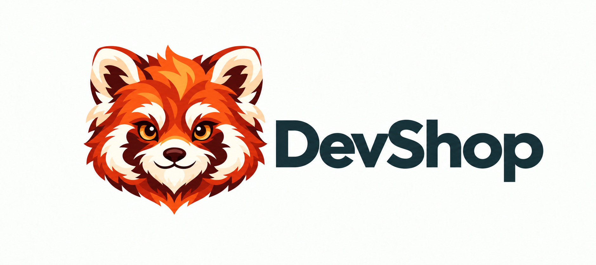

<p align="center">
  
</p>

# DevShop

## 目录

- [项目简介](#项目简介)
- [主要功能](#主要功能)
- [快速开始](#快速开始)
- [Windows 安装与文件打开](#windows-安装与文件打开)
- [开发与打包](#开发与打包)
- [本地数据与限制](#本地数据与限制)
- [项目结构与文档](#项目结构与文档)
- [许可证](#许可证)

## 项目简介

DevShop 是使用 Rust 和 `eframe/egui` 编写的本地 JSON / JWT 桌面工作台。针对大 JSON 浏览卡顿、难以搜索、需要反复打开网页的问题，提供后台解析、树形浏览、内容搜索、节点编辑，以及 JWT 解码、签名和验签。

与 SQLShop、LinkShop、RPShop 使用相同的目录职责、Windows 标题栏、单实例文件转发和打包约定。无需产品账号；内容不上传，应用不自动获取远程密钥或发送网络请求。

## 主要功能

| 功能 | 说明 |
| --- | --- |
| JSON 浏览与编辑 | 树形和原文视图、展开折叠、格式化与压缩、节点编辑、原文和路径复制。 |
| 内容搜索 | 搜索字段名、值或两者，支持大小写和正则；覆盖折叠节点，显示命中总数并定位结果。 |
| 大文件处理 | 后台解析、格式化、搜索和树行计算；界面只绘制可见行，保留数字原文、字段顺序和重复字段。 |
| JWT 工作台 | Header / Payload 解码与编辑、12 种算法签名和独立验签、常用声明和时间状态查看。 |
| 悬浮球 | 独立置顶窗口，支持拖动、打开主窗口、读取剪贴板、查看历史、隐藏和完全退出。 |
| 历史与保存 | 本地快照、来源与处理操作、来源链回溯、收藏、清理、保存和另存为。 |
| 桌面界面 | 暖橙色小熊猫主题，支持深浅外观、可调整窗口和分区；Windows 提供统一标题栏、开始菜单固定入口和单实例文件转发。 |

## 快速开始

### 使用发布包

当前版本为 **1.0.0**。正式版本附件从 [Releases](https://github.com/RichieLuo/devshop/releases) 下载；分支构建产物见 [Actions → 跨平台打包](https://github.com/RichieLuo/devshop/actions/workflows/release.yml)，下载与解压步骤见 [构建说明](docs/github-actions.md)。

完整解压后，Windows 双击版本目录中的 `devshop.exe`，macOS、Linux 运行 `devshop`。直接运行无需安装 Rust、Visual Studio 或 Python；需要 Windows 开始菜单入口和文件“打开方式”时，再按下一节安装。各平台的实际验证范围见 [验证记录](docs/verification.md)。

### 从源码启动

源码开发使用 `rust-toolchain.toml` 固定的 Rust 1.95.0，需先安装 Rust / rustup。Windows 还需要 MSVC C++ 工具链和 Windows SDK；脚本优先加载完整的 Visual Studio 2022 工具链。在项目根目录运行：

```powershell
powershell -ExecutionPolicy Bypass -File .\scripts\dev.ps1 run
```

在已初始化的开发终端或 macOS/Linux 上，也可直接运行或指定文件：

```sh
cargo run --locked
cargo run --locked -- --open ./examples/sample.json
cargo run --locked -- --open ./examples/sample.jwt
```

脚本沿用 Cargo 注册表配置，旧的 `-CratesIo` 参数仍可接受。

### 基本操作

1. 打开 JSON / JWT 文件，拖入文件，或点击“读取剪贴板”。也可以在 JSON 原文区直接输入。
2. JSON 解析后使用树形视图；输入关键字搜索，点击结果定位，右侧查看或编辑节点。
3. JWT 页面可解码 Token，编辑 Header / Payload 后生成签名。验签算法由用户明确选择，密钥只保留在当前会话。
4. 使用“保存 / 另存为”输出独立文件，或从左侧历史重新打开快照。历史右键提供收藏与回溯入口。
5. 悬浮球单击打开工作台、拖动移动、右键显示菜单。启用悬浮球时，关闭主窗口会隐藏窗口并继续运行；完全退出从设置或悬浮球菜单操作。

| 快捷键 | 操作 |
| --- | --- |
| `Ctrl/⌘+O` | 打开文件 |
| `Ctrl/⌘+N` | 新建当前类型的文档 |
| `Ctrl/⌘+S` | 保存 |
| `Ctrl/⌘+Shift+S` | 另存为 |
| `Ctrl/⌘+Shift+V` | 读取剪贴板并识别 JSON / JWT |
| `Ctrl/⌘+F` | 聚焦 JSON 内容搜索 |
| `Ctrl/⌘+H` | 显示 / 隐藏历史侧栏 |

## Windows 安装与文件打开

### 首次安装

安装需要 Python 3.9+ 和正在运行的 Windows 资源管理器（Explorer），不需要管理员权限。从源码首次打包并安装时，先准备上述开发环境，再运行：

```powershell
powershell -ExecutionPolicy Bypass -File .\scripts\package.ps1 -Install -OutputDirectory .\dist\installed-candidate
```

安装后可从开始菜单的 `Shop → DevShop` 启动。已有完整解压包也可在包内运行以下命令，无需源码构建环境；详见 [Windows 用户安装与文件打开方式](docs/windows-installation.md)。

```powershell
powershell -ExecutionPolicy Bypass -File .\install.ps1
```

### 后续更新

之后，同一仓库的普通成功打包会自动更新已有安装；同版本再次打包需使用新的输出目录，避免覆盖旧包。加 `-NoInstall` 可跳过更新，持续集成和跨平台打包也会跳过。快捷方式始终指向 `%LOCALAPPDATA%\Programs\Shop\DevShop\DevShop.exe`，固定启动器读取最新完整版本的位置；正在运行的实例保留当前会话，完全退出后重新启动才使用新版。

### 文件关联

安装会把 `.json`、`.jwt` 注册到“打开方式”。在文件右键菜单选择 DevShop 即可打开，也可手动传入路径：

```powershell
.\devshop.exe --open "C:\data\response.json"
```

Windows 下，同一用户登录会话中的图形界面保持单实例。再次启动会将文件转交已有窗口，并恢复、聚焦窗口；替换工作区前保留未保存确认。安装脚本不静默更改默认应用，也不修改 `UserChoice`；默认打开方式由用户在 Windows 设置或“打开方式”中选择。

## 开发与打包

### 开发检查

```powershell
powershell -ExecutionPolicy Bypass -File .\scripts\dev.ps1 verify
python -m unittest discover -s scripts/tests -v
python scripts/check-structure.py
```

`verify` 依次检查格式、Clippy 和默认测试；脚本测试覆盖打包与安装契约，结构检查约束模块大小。真实 Explorer roundtrip、编译后启动器和大文件性能测量为可选检查，启用方式见 [验证记录](docs/verification.md)及 [Windows 安装说明](docs/windows-installation.md)。

### 发布打包

打包需要 Python 3.9+，使用与源码开发相同的 Rust 工具链。

```powershell
powershell -ExecutionPolicy Bypass -File .\scripts\package.ps1
```

Windows x64 包输出到 `dist/DevShop-<version>-windows-x64/`，同时生成同名 ZIP 和 `.sha256` 校验文件，内含程序、安装入口、使用说明、`package.json` 及第三方许可。Windows 构建使用静态 MSVC 运行库，已有同名包不会覆盖；可用 `-OutputDirectory .\dist\new-candidate` 指定新目录，或用 `-NoInstall` 只生成便携包。`dev.ps1 release` 只编译，不生成发布包。

macOS/Linux 使用 `python3 scripts/package.py --no-install` 打包，产物为 tar.gz。详见 [架构与打包约定](docs/architecture.md)。

### 持续集成

沿用 Shop 系列相同的 [Rust 检查](https://github.com/RichieLuo/devshop/actions/workflows/ci.yml)和 [跨平台打包](https://github.com/RichieLuo/devshop/actions/workflows/release.yml)工作流，统一使用 Rust 1.95.0 和锁定依赖：

- 持续集成在 Windows、macOS、Linux 上检查格式、Clippy、默认测试、打包安装契约和模块结构。
- 向 `main` 推送、创建或更新拉取请求、手动运行时，构建 Windows x64、macOS Intel、macOS Apple Silicon、Linux x64 四类便携包及 SHA-256，Actions 产物保留 30 天。
- 只有推送与 `Cargo.toml` 版本一致的 `v<version>` 标签，且四个平台全部打包成功，才创建或更新 GitHub Release 附件。普通提交不会自动发布 Release。

工作流调用与本机相同的打包脚本，并显式跳过当前用户安装；每个平台在任务摘要中列出下载链接和文件大小。详见 [Actions 构建与下载说明](docs/github-actions.md)。

## 本地数据与限制

### 本地数据

历史默认位于 Windows `%LOCALAPPDATA%\DevShop`、macOS `~/Library/Application Support/DevShop`、Linux `$XDG_DATA_HOME/devshop` 或 `~/.local/share/devshop`。测试可用 `DEVSHOP_DATA_DIR` 指定隔离目录。

历史使用原子写入的索引及按 SHA-256 标识的内容快照，保留来源、操作、时间和前序记录。默认保留最近 100 条未收藏记录及不超过 512 MiB 的未收藏内容；收藏不自动清理。可关闭自动历史，也可手动记录和清理。

JWT 历史和文件只包含 Token，不包含签名密钥。Token 本身仍可能包含个人或业务信息，历史是本地明文快照。

### 支持范围

JSON 支持标准 JSON 的浏览、搜索、格式化、压缩和节点编辑，保留数字原文、字段顺序与重复字段。JSONPath / JSON Pointer 用于定位和复制，暂不提供完整 JSONPath 查询语言；JSON5、注释和尾逗号会作为错误显示，不自动修复。

JWT 最大 2 MiB，支持 HS256/384/512、RS256/384/512、PS256/384/512、ES256/384、EdDSA 共 12 种算法。解码、签名匹配与时间声明状态分别展示；验签算法由用户明确选择，密钥只保留在当前会话。

### 使用限制

- 文件读取上限为 256 MiB；JSON 核心上限为 512 MiB、500 万节点、嵌套 256 层。实际内存还包括源文本、节点索引及处理中间结果。
- 不超过 2 MiB 的 JSON 可全文编辑。较大文档使用树形浏览和节点编辑；单个可编辑节点上限为 2 MiB。原文视图按可见行绘制，超长行和过多行有明确预览限制，内容搜索仍遍历全部节点。
- 搜索显示完整命中总数，最多提供前 10,000 个匹配节点供导航。正则使用 Rust `regex` 语义。
- JWT 不支持 JWE、`none` 和关键扩展头；工具不代替服务端完整认证策略。
- 未应用的节点草稿和未签名的 JWT 草稿需要先应用 / 签名，或明确取消；保存失败保留当前内容。外部文件变化会阻止直接覆盖。
- 悬浮球需要程序正在运行，不会自行添加系统开机启动项。
- 程序包未签名，macOS 包未公证，Linux 运行需要相应系统动态库。

## 项目结构与文档

| 路径 | 职责 |
| --- | --- |
| `src/main.rs`、`src/app.rs` | 桌面启动和窗口参数 |
| `src/shell_open.rs`、`src/shell_open/` | 文件打开参数与 Windows 单实例转发 |
| `src/json/` | JSON 解析、节点索引、格式化、搜索 |
| `src/jwt/` | JWT 解码、算法、签名验证、声明解读 |
| `src/storage/` | 文件保存、历史索引、快照 |
| `src/ui/` | 工作区、后台任务协调、悬浮球和窗口 |
| `src/branding.rs`、`src/branding_icon.rs`、`assets/branding/` | 品牌资源、配色与图标生成 |
| `scripts/`、`.github/workflows/` | 开发、打包、安装、结构检查与持续集成 |
| `tests/`、`examples/` | 行为验证、合成样本和性能测量 |

`src/lib.rs` 导出 JSON、JWT 和存储模块，桌面界面通过库调用业务逻辑。测试覆盖解析与搜索、签名验签、历史与文件一致性、草稿保护、窗口图标和缩放行为。

- [架构与维护约定](docs/architecture.md)
- [图标与标题栏规范](docs/branding.md)
- [REA 网站行为观察](docs/reference-observations.md)
- [验证记录](docs/verification.md)
- [Windows 安装](docs/windows-installation.md)
- [GitHub Actions](docs/github-actions.md)

## 许可证

当前仓库尚未指定项目级开源许可证。依赖和内嵌资产保留各自许可，字体使用 SIL Open Font License；发布包附带第三方许可清单。
